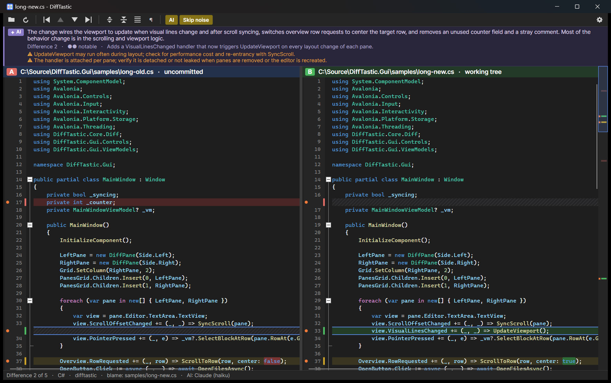
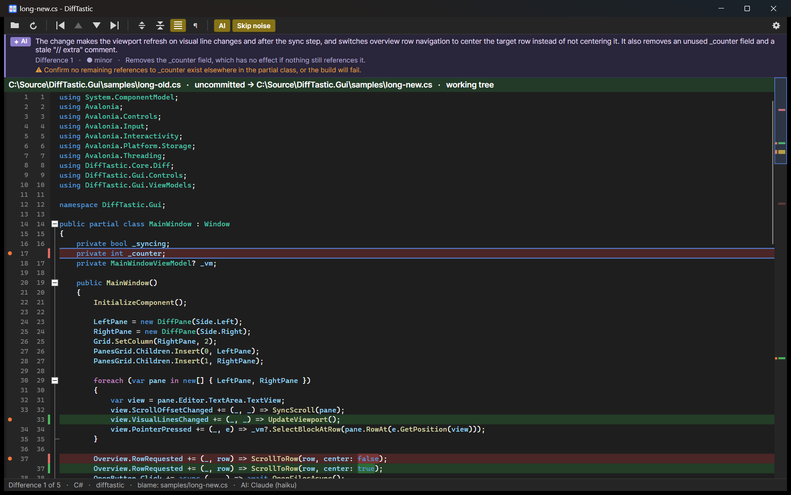
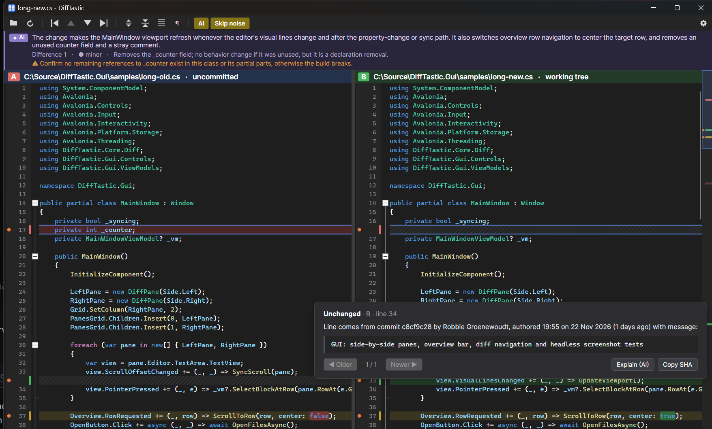

# DiffTastic

A side-by-side diff viewer for Windows and Linux that understands your code. It is built on [difftastic](https://difftastic.wilfred.me.uk/), so it compares code by its structure instead of line by line: you see what really changed, not just which lines moved around.



## Why DiffTastic

- **See the real change.** Both files are shown next to each other, lined up, with the changed characters highlighted. Formatting-only changes don't drown out the real ones.
- **Spot moved code.** Code that was cut from one place and pasted in another is shown in purple. Click it to jump to where it came from or went to.
- **Know who changed it and why.** Hover a line to see the commit that last touched it, and step back through its full history.
- **Get a second opinion.** Optionally let AI summarize the change, point out the differences that matter, and answer your questions about the code.
- **Works with git.** Use it as your `git difftool`.

## Features

### Navigating a diff

- Jump to the previous or next difference (Ctrl+Up / Ctrl+Down, first and last with Ctrl+Home / Ctrl+End).
- The overview bar shows where all differences are in the file.
- Search both files at once (Ctrl+F, then F3 / Shift+F3).
- Go to a line in either file (Ctrl+G).
- Switch between side-by-side and unified view.
- The status bar counts added, removed and moved lines.



### Line history

Hover a line to see the commit that last changed it. Use **Older / Newer** to walk through every commit that touched that line.



### AI review (optional)

If you have [Claude Code](https://claude.com/claude-code) or [Codex](https://github.com/openai/codex) installed, an **AI** toggle appears in the toolbar. It is off by default. Turn it on to get:

- a short summary of the change,
- per difference: how important it is, why, and what to check when reviewing,
- **Skip noise**: jump past differences that only change formatting, names, comments or imports,
- **Explain (AI)** in the line history: what a commit did to that line,
- **Ask AI…** in the right-click menu: ask anything about a difference or the selected code.

It uses your existing login and the cheapest model by default. Your changed code is sent to Anthropic or OpenAI, so only turn it on when that is allowed for your code. Use the gear button in the toolbar to change the settings.

### Details that help

- Syntax highlighting for many languages.
- Shows when the files differ in encoding (UTF-8, UTF-16, ANSI) or line endings (CRLF / LF).
- Still works without difftastic: it then falls back to a plain line diff.

## Download

Get the latest version from [Releases](https://github.com/rgroenewoudt/DiffTastic.Gui/releases):

- Windows: `win-x64` zip
- Linux: `linux-x64` tar.gz

Unpack and run. Everything is included; no installation of .NET or difftastic needed.

## Usage

```
DiffTastic.Gui <left file> <right file>
```

### As git difftool

Add this to your git config (use the path where you unpacked DiffTastic):

```ini
[difftool "difftastic-gui"]
    cmd = "C:/path/to/DiffTastic.Gui.exe" "$LOCAL" "$REMOTE" --path "$MERGED"
[diff]
    tool = difftastic-gui
```

On Linux use the path to `DiffTastic.Gui` instead. Then run, for example:

```
git difftool HEAD~3 -- some/file.cs
```

The `--path` argument lets DiffTastic show line history for both sides of the diff.

## Building from source

Requires the .NET SDK.

```powershell
./tools/get-difft.ps1   # downloads difftastic into tools/difft
dotnet build
dotnet test
```

See [CLAUDE.md](CLAUDE.md) for an overview of the code.

## License

MIT. difftastic is also MIT licensed.
